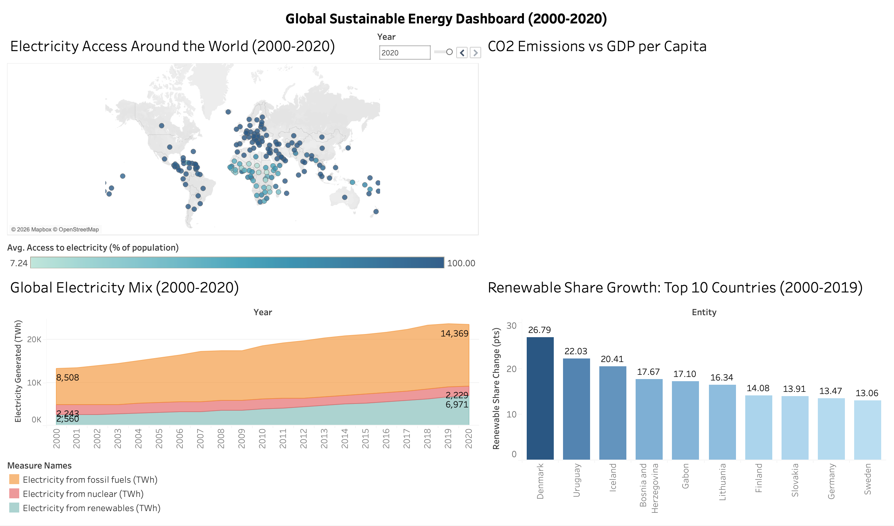
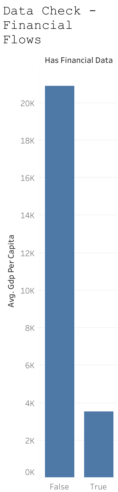

# Global Sustainable Energy Dashboard (2000-2019)

Interactive dashboard on global sustainable energy indicators (electricity access, energy mix, renewable share, CO2 emissions) across 176 countries, built from a dataset spanning 2000-2020 (the dashboard's own year control tops out at 2019, see Known limitations). This is a portfolio project built as part of a transition into data analytics, focused on data visualization rather than data cleaning (see the other portfolio projects for that).

**[View the live dashboard on Tableau Public](https://public.tableau.com/app/profile/thibaut.r4710/viz/sustainable_energy_dashboard/Dashboard1)**

A short screen recording of the dashboard in use is available here: [images/Recording.mov](images/Recording.mov).

## What it covers

A single **Year Control** parameter (2000-2019) drives one slider that syncs the selected year across all four views at once.

- **Electricity Access Around the World**: world map of electricity access (% of population) by country
- **Global Electricity Mix**: fossil / nuclear / renewable electricity generation (TWh) stacked over time, with the selected year highlighted and other years greyed out
- **Renewable Share Growth Since 2000: Top 10 Countries**: countries with the largest gain in renewable energy share between 2000 and the selected year, benchmarked against the world average
- **CO2 Emissions vs GDP per Capita**: CO2 emissions per capita against GDP per capita for the selected year, one point per country, with statistical outliers (more than 2 standard deviations from the year's average on either axis) labeled directly on the chart

## Data

Source: [Global Data on Sustainable Energy (2000-2020)](https://www.kaggle.com/datasets/anshtanwar/global-data-on-sustainable-energy) on Kaggle, by Ansh Tanwar.

File: `global_sustainable_energy.csv` (176 countries, 2000-2020, 21 columns).

## Data Preparation (done directly in Tableau Public, no separate cleaning step)

Two columns had significant missing values and were checked before deciding whether to keep or exclude them:

| Column | Missing | Decision | Why |
|---|---|---|---|
| `Financial flows to developing countries (US $)` | 57% (2,089 / 3,649 rows) | **Kept** | The missing values are not random: rows without a value have an average GDP per capita of $20,895, versus $3,521 for rows with a value. Missing means "not an aid recipient" (likely a high-income country), which is meaningful information, not a data quality issue. |
| `Renewables (% equivalent primary energy)` | 59% (2,137 / 3,649 rows) | **Excluded** | Missing values do not reliably mean "no renewable energy": 1,585 of the missing rows still have positive `Electricity from renewables (TWh)`. The gap looks like a coverage limitation of this specific metric's source, not a real-world signal, so it isn't safe to visualize as-is. |

Verification check for the `Financial flows` decision (average GDP per capita, split by whether the row has a value):

Also fixed: the `Density (P/Km2)` column header contained a literal line break in the source file, renamed for clean display in Tableau.

## Key calculated fields

- **`Year Control`**: an integer parameter (range 2000-2019) bound to a single dashboard slider, used by all four worksheets to stay in sync
- **`Renewable Share 2000`**: isolates each country's renewable energy share in the baseline year (`IF [Year] = 2000 THEN ... END`)
- **`Renewable Share Selected Year`**: same idea, but for whichever year `Year Control` is set to, so the comparison updates live with the slider instead of being fixed to one year
- **`Renewable Share Change`**: a `{FIXED [Entity] : MAX(...)}` LOD expression comparing `Renewable Share 2000` to `Renewable Share Selected Year` on a single row, regardless of the active filter
- **`World AVG renew share change`**: a table-wide `{FIXED : AVG(...)}` LOD expression, used as a reference line so the Top 10 chart can be benchmarked against the true world average rather than the average of the 10 countries shown
- **`Is Selected Year` / `Show Selected Year` / `Grey Mask`**: highlight the year picked by `Year Control` on the map and the electricity mix chart, greying out the other years
- **`CO2 Z-Score` / `GDP Z-Score`**: `({FIXED [Year] : ...} - mean) / stddev` for CO2 per capita and GDP per capita, computed per year so a country's outlier status is relative to that year's distribution, not the whole 2000-2020 range
- **`Outlier Label`**: returns the country name when `|CO2 Z-Score| > 2` or `|GDP Z-Score| > 2`, used as a text label on the scatter plot
- **`Population (estimated)`**: `Density × Land Area`, used to derive a per-capita view (see limitation below)
- **`CO2 per Capita`**: `Value_co2_emissions_kt_by_country × 1000 / Population (estimated)`, converting kilotonnes to tonnes per person

## Known limitations

- **Estimated population.** The dataset has no direct population column, so population is approximated as `Density × Land Area`. Cross-checking against France's real population (~67.4M) shows a ~13% overestimation (76.6M), caused by a scope mismatch between the two source columns: `Land Area` appears to include overseas territories, while `Density` reflects metropolitan France only. `CO2 per Capita` and `Population (estimated)` should be read as directional, not exact.
- **`Year Control` tops out at 2019, not 2020.** Since the same parameter now drives all four charts, and the renewable share field has near-complete missing data in 2020, the whole dashboard is capped at 2019 rather than just the Top 10 chart, even though the map and electricity mix data do extend to 2020.

## Tech stack

- **Tableau Public**: data connection, calculated fields (LOD expressions, Z-score outlier detection), map, stacked area chart, bar chart with reference line, scatter plot, dashboard with a single cross-chart parameter control (replacing per-worksheet filter actions)
